<p align="center"></p>

# Dual-Model Workflow

A lightweight protocol for pairing two AI coding models — one as **Overseer**, one as **Worker** — coordinated through a few plain Markdown files. Solves single-model context exhaustion and role confusion.

**English · [中文](README.zh-CN.md)**

> Runs on the [Claude Code](https://claude.com/claude-code) CLI — install that first; this repo does not install it. A Claude account is **optional**: either role can run on any Anthropic-compatible model endpoint. See [Prerequisites](#prerequisites).

**Contents:** [The problem](#the-problem) · [Two roles](#two-roles) · [How a round works](#how-a-round-works) · [The files](#the-files) · [Prerequisites](#prerequisites) · [Quick start](#quick-start) · [Switching roles](#switching-roles) · [Advanced topics](#advanced-topics) · [License](#license)

---

## The problem

When you use one AI model for a long coding session, two things go wrong:

1. **Context exhaustion** — as the conversation grows, the model loses early context, repeats mistakes, and drifts off course.
2. **Role confusion** — you want it to make architecture decisions, it edits code details; you want it to execute, it keeps asking you for direction.

This workflow splits the work across **two models with separate roles**, and manages the shared state in plain files so each model only does what it's good at.

## Two roles

- **Overseer (`cc`, any model — e.g. Claude)** — direction, decisions, review. Does not read large numbers of files, does not iterate on details. Steps in only at key moments: set architecture at kickoff, decide when the Worker hits a fork, review at phase boundaries.
- **Worker (`cc-alt`, any model — e.g. DeepSeek)** — execution, iteration, detail implementation. Reads files, looks things up, writes code, fixes bugs. The role that actually does the work.

The two roles run in separate terminal sessions: `cc` starts the Overseer, `cc-alt` starts the Worker. (`cc` and `cc-alt` are shell functions defined by this repo's helper file — see the Quick start — not commands that ship with Claude Code.)

## How a round works

```mermaid
%%{init: {"htmlLabels": false, "flowchart": {"htmlLabels": false, "padding": 16, "nodeSpacing": 60, "rankSpacing": 130}}}%%
flowchart LR
    O["Overseer<br/>sets direction · decides · reviews"]
    CTX[("context.md<br/>shared handoff file")]
    W["Worker<br/>writes code · iterates · commits"]

    O -->|"1. write decisions, tasks"| CTX
    CTX -->|"2. read tasks, start"| W
    W -->|"3. commit, write handoff"| CTX
    CTX -->|"4. read handoff, approve"| O

    classDef overseer fill:#dbeafe,stroke:#2563eb,color:#1f2328
    classDef worker fill:#dcfce7,stroke:#16a34a,color:#1f2328
    classDef file fill:#fef9c3,stroke:#ca8a04,color:#1f2328
    classDef script fill:#f1f5f9,stroke:#64748b,color:#1f2328
    classDef third fill:#f3e8ff,stroke:#9333ea,color:#1f2328
    classDef user fill:#ffffff,stroke:#334155,color:#1f2328
    class O overseer
    class W worker
    class CTX file
```



Messages between the two sessions only wake the other side up; every decision goes into `context.md`, so a fresh session on either side can pick up from the files alone. More detailed diagrams — who reads and writes which file, what the Overseer checks each round, and the full sequence of one handoff — are in [`docs/diagrams.en.md`](docs/diagrams.en.md) (a Chinese version is in [`docs/diagrams.md`](docs/diagrams.md)). In those diagrams blue = Overseer, green = Worker, yellow = files, grey = scripts and checks, purple = third-party reviewers.

## The files

The authoritative per-project file list — what each file is for, who reads it, who writes it — is the 「文件分工」 table in [`templates/WORKFLOW.md`](templates/WORKFLOW.md). This README deliberately doesn't restate the count; a copied number drifts. The ones you touch most:

- **`WORKFLOW.md`** — the rules: each role's responsibilities, switch trigger conditions, and the `context.md` write formats. Both models read this on startup so behavior stays consistent.
- **`CLAUDE.md`** — project-level startup instructions: every session must (1) read `WORKFLOW.md`, (2) read `context.md` (top status block first, then latest history), (3) restate "I am [role], current task is: [summary]" and begin.
- **`context.md`** — the core. A top `## Current State` block (rewritten by the Overseer each round — the latest task list; the Worker only appends new entries to the backlog and unverified-premise lists, never overwrites it) plus an append-only history log (timestamped records of every decision and execution step).

They live in every project that uses the workflow. Two optional documents sit at the repository level instead and are not part of the per-project set: [`CROSS-MACHINE.md`](CROSS-MACHINE.md) (Overseer and Worker, or two Overseers, on different machines) and [`channel-starter/`](channel-starter/) (a dedicated letter-channel repository for projects that share no repository).

### What `context.md` looks like

An excerpt from a fictional project: first the Overseer's "Current State" block, then the Worker's handoff after finishing. (The shipped templates are written in Chinese; this excerpt is translated.)

```markdown
## Current State
**Phase:** Phase 1 / API skeleton
**Current task:** implement POST /todos
**Task list (for the Worker):**
- [ ] Task 1: schema and migration (done when: `pytest tests/test_db.py` exits 0, re-runnable)
- [ ] Task 2: POST /todos returns 201 (done when: `pytest tests/test_todos.py` exits 0, re-runnable)
**Unverified premises:**
- [ ] SQLite is enough for the expected load — source: the estimate in the spec, not re-checked on this side; to verify: 100 concurrent writes
**Backlog:** none

## [2026-01-15 10:20] Worker — POST /todos done
**Outcome:** commit `a1b2c3d`; tasks 1 and 2 done
**Gate results:**
- unit tests (re-runnable): `pytest tests/test_todos.py` — rc=0; passed this round; first run
**Key decision points:**
- Architecture / interface changes: new POST /todos (201 + JSON)
- Security-relevant: none
- Deviations from plan: none
- Open doubts: none
```


## Prerequisites

- **Claude Code** installed — `claude --version` should print a version. This repo does not install it.
- **A model for each role.** A Claude account is optional: either role can run on any Anthropic-compatible endpoint. The Worker example in the Quick start uses DeepSeek and needs a `DEEPSEEK_API_KEY`.
- **bash and git** (Linux / macOS), or **PowerShell plus Git for Windows** (Windows).

The full details — versions, what is core and what is optional, and how to point the Overseer at a non-Claude endpoint — are in "Prerequisites in detail" under [Advanced topics](#advanced-topics).

<a id="quick-start"></a>

## Quick start — Linux / macOS (bash)

```bash
# 0. Prerequisites (see above) — stop here if this prints the "not found" line
command -v git >/dev/null || echo "git not found"
command -v claude >/dev/null && claude --version || echo "claude not found — install Claude Code first (see Prerequisites)"

# 1. Clone
git clone https://github.com/Haven16262/dual-model-workflow.git
cd dual-model-workflow

# 2. Make templates discoverable (default location)
mkdir -p ~/.dual-model/templates
cp -r templates/. ~/.dual-model/templates/
#   (the trailing dot copies hidden entries like .claude/ too)
#   (or: export DUAL_MODEL_TEMPLATES=/abs/path/to/dual-model-workflow/templates)

# 2b. Install the scripts: security precheck (Overseer, before every review) and
#     workflow-mode rules (read by cc / cc-alt) are core; ctx-*.py (context.md length and
#     dangling-pointer checks) and sessions-md.py (session registry) are also run by the Overseer
#     every round / handoff; the k10-*.py files are the optional third-party-review hooks +
#     watcher — copying them is harmless
mkdir -p ~/.claude/scripts
cp scripts/security-scan.sh scripts/dual-model-mode.sh scripts/k10-*.py scripts/ctx-*.py scripts/sessions-md.py ~/.claude/scripts/

# 3. Export your DeepSeek key in your shell profile (NEVER commit this)
echo 'export DEEPSEEK_API_KEY="sk-your-deepseek-key"' >> ~/.bashrc

# 4. Source the helpers
echo 'source '"$PWD"'/linux/dual-model.sh' >> ~/.bashrc
source ~/.bashrc

# 5. In any project directory, initialize the workflow
cd /path/to/your/project
cc-init        # copies WORKFLOW.md + CLAUDE.md + context.md + .claude/{commands,agents,settings.json} + .workflow/

# 6. (optional — competition-mode projects only) schedule the K9 watcher — see WORKFLOW.md, section K10
#    */30 * * * * flock -n /tmp/k10-<proj>.lock ~/.claude/scripts/k10-watch.py /path/to/project >> /path/to/k10.log 2>&1
```

> **Naming note:** `cc` shadows the system C compiler (`/usr/bin/cc`) in interactive shells. If you do C development, rename the functions in `linux/dual-model.sh` (e.g. `dm`, `dm-ds`, `dm-init`).

<details>
<summary><b>Quick start — Windows (PowerShell)</b></summary>

```powershell
# 0. Prerequisites (see above)
if (-not (Get-Command git -ErrorAction SilentlyContinue)) { Write-Host "git not found" }
if (Get-Command claude -ErrorAction SilentlyContinue) { claude --version } else { Write-Host "claude not found - install Claude Code first (see Prerequisites)" }

# 1. Clone
git clone https://github.com/Haven16262/dual-model-workflow.git
cd dual-model-workflow

# 2. Make templates discoverable (default location)
New-Item -ItemType Directory -Force "$env:USERPROFILE\.dual-model\templates" | Out-Null
Copy-Item -Recurse -Force templates\* "$env:USERPROFILE\.dual-model\templates\"
Copy-Item -Recurse -Force templates\.claude "$env:USERPROFILE\.dual-model\templates\"
Copy-Item -Recurse -Force templates\.workflow "$env:USERPROFILE\.dual-model\templates\"
#   (the wildcard skips hidden dirs, so .claude/ and .workflow/ need their own copy)
#   (or: $env:DUAL_MODEL_TEMPLATES = "C:\abs\path\to\dual-model-workflow\templates")

# 2b. Install the security precheck script (runs under Git Bash, which comes with Git for Windows — Claude Code does not ship it)
New-Item -ItemType Directory -Force "$env:USERPROFILE\.claude\scripts" | Out-Null
Copy-Item scripts\security-scan.sh "$env:USERPROFILE\.claude\scripts\"
#     K10 hooks (optional, Python): the hook command tries python3 then python and only uses one that
#     actually runs (Git Bash may find a Store stub named python3); scripts force UTF-8 I/O.
#     2026-09-29: byte-level checked on MSI; end-to-end in CC still pending. k10-watch.py needs
#     cron + flock and is NOT set up for Windows.
Copy-Item scripts\k10-*.py "$env:USERPROFILE\.claude\scripts\"
Copy-Item scripts\ctx-*.py "$env:USERPROFILE\.claude\scripts\"
Copy-Item scripts\sessions-md.py "$env:USERPROFILE\.claude\scripts\"

# 3. Prepare the settings file for model switching (NEVER commit the key)
#    ~\.claude\settings.deepseek.json  — DeepSeek endpoint env + API key (Worker)
#    (the Overseer just uses your normal ~\.claude\settings.json — nothing to prepare)

# 4. Dot-source the helpers in your PowerShell profile
Add-Content $PROFILE ". `"$PWD\windows\dual-model.ps1`""
. $PROFILE

# 5. In any project directory, initialize the workflow
cd C:\path\to\your\project
cc-init        # copies WORKFLOW.md + CLAUDE.md + context.md + .claude/{commands,agents,settings.json} + .workflow/
```

Then use two terminals: `cc` for the Overseer, `cc-alt` for the Worker. Each silently injects the role into the system prompt (via `--append-system-prompt`, not sent as a chat message — your first message stays free for whatever you want to say) and reads `WORKFLOW.md` / `context.md` to restore state.

After you pick a role, the helper also asks for a **topic for this round** (optional, Enter to skip). Together with the machine tag, the project directory, and the role it forms the session name, passed via `--name`, in four segments:

```
<machine>-<project-dir>-<role>-<topic>        # e.g. vps-bili-overseer-login-rework
<machine>-<project-dir>-<role>-<MMDD-HHMM>    # fallback when you skip the topic
```

Each segment earns its place; drop one and something breaks:

- **Machine tag** — read from `~/.claude/machine-tag`. It is *not* there to help the AI tell machines apart: across machines a peer shows up under its Remote Control name, which already carries the hostname. It is for **you**. The same git repository checked out on two machines has the same directory name, so without the prefix your session list on claude.ai and on your phone shows two byte-identical rows and you have to open one to find out which machine it is. No tag file, no prefix — the other three segments are unchanged.
- **Project directory** — with two projects running the workflow at once, a fixed name like `worker` would deliver a handoff to the *other project's* Worker. Worse than no automation at all.
- **Role** — tells the two terminals of one project apart, and is what a handoff is aimed at.
- **Topic** — without it every launch of the same project produces an identical name, and the `/resume` picker fills with rows you can't tell apart. `--name` also **overrides** the summary title Claude Code would have generated on its own, so a fixed name doesn't just fail to help — it replaces a useful title with a useless one.

The cost: the sender can no longer compute the peer's full name from its own cwd, since the topic is typed at the peer's own launch. It has to look the name up before sending — see the next section.

</details>

## Switching roles

The Worker finishes a phase or hits a decision it can't make, writes to `context.md`, and says *"written to context.md, please switch to the Overseer."* You go to the Overseer terminal and type:

> *The Worker changed something, check the context file.*

The Overseer reads it, gives a decision, writes to `context.md`, and says *"decision written, switch back to the Worker."* You go to the Worker terminal and type:

> *The Overseer changed something, check the context file.*

These two phrases are the switch signals — the model reads `context.md` on receiving them, so you never have to re-explain the background.

**Slash command alternative:** the same two switch signals are also wired up as slash commands (defined in `templates/.claude/commands/`):

- In the Overseer terminal: `/as-overseer` ≡ *"The Worker changed something, check the context file"* (i.e. "I'm now stepping in as Overseer")
- In the Worker terminal: `/as-worker` ≡ *"The Overseer changed something, check the context file"* (i.e. "I'm now stepping in as Worker")

(The `as-` naming is mnemonic: you state the role you're about to take. It's also faster to type than `from-` since `a` and `s` are adjacent on QWERTY.)

Same semantics, less typing. Hand-typed phrases still work.

## Trigger conditions (Worker → Overseer)

The authoritative list is the 「切换触发条件」 section of [`templates/WORKFLOW.md`](templates/WORKFLOW.md); it is not copied here because a copy already drifted once (this README listed four conditions while the template had grown more). In short: the Worker stops and hands back on architecture forks, security- or performance-relevant design decisions, a finished module, repeated failed attempts, and — immediately, without trying first — an ambiguous or contradictory spec or a premise that turns out false.

The repeated-failure condition matters — rather than let the Worker burn tokens trial-and-erroring, switch to the Overseer for a fresh angle.

## The review mechanism — and why

Early versions had a hidden flaw: **the Overseer was nominally supposed to "review the Worker's output at phase boundaries," but it wasn't actually reviewing anything.**

The cause was the write format. The Worker only wrote a *completion summary* and *task progress* — all **results** (what got done), no **decisions** (how, what was touched). The Overseer, holding a results summary, had no way to tell whether direction had drifted or a security pitfall was hit. Review stayed at the "looks done" surface.

The fix is not to make the Overseer read all the code (that violates its "don't read large numbers of files" principle), but to make the Worker surface key decisions on delivery. The Worker write format now carries a mandatory four-item checklist:

```
**Key decisions:** (answer every item explicitly; write "none" if none — never leave blank)
- Architecture / interface changes: ...
- Security-relevant: touches auth / secrets / user input / SQL / file paths / outbound requests?
- Deviations from plan: ...
- Unresolved doubts: things pushed past without confidence
```

This deliberately separates **fact reporting** from **risk judgment**: the Worker only answers factually ("did you change an interface", "did you touch these security-sensitive surfaces") — answerable even without understanding the risk; the Overseer judges the risk. "Unresolved doubts" is the single highest-value line — it catches the blind spot where **the Worker isn't blocked, so it never triggers a switch, but it's actually unsure**. That case used to fall straight through the net.

A paired hard rule for the Overseer: **whenever the security item is non-empty, it must invoke the `critic` subagent** (defined in [`templates/.claude/agents/critic.md`](templates/.claude/agents/critic.md), runs on Haiku) to read the relevant files and return a structured audit, rather than relying on the summary. This operationalizes the "must read code" rule without making the Overseer itself read large numbers of files — the critic does the reading and reports back; the Overseer judges from the report.

That still leaves a gap: the escape hatch is gated on the Worker's self-report, and models reflexively fill "none" (see the caveat below). The fix is an objective trigger that doesn't depend on self-reporting: before every review, the Overseer runs [`scripts/security-scan.sh`](scripts/security-scan.sh) — a pure local `grep` over the diff's added lines (zero token cost, no model call) that flags security-sensitive keywords (auth/secrets, SQL, command execution, path traversal, outbound requests). **A hit or a non-empty security item — either one — forces the `critic` invocation.** A hit doesn't mean there's a real problem, only that review gets escalated to mandatory; the script is a trigger, not a verdict.

## Why this patch doesn't auto-work (the honest caveat)

Be honest about one thing: the whole mechanism rests on the **Worker self-reporting honestly**, and the Worker is a smaller/cheaper model. Models tend to reflexively fill all four items with "none" to close out faster — especially "unresolved doubts" (admitting uncertainty is exactly what models least want to do). Once it writes "none" on the security item where it shouldn't, the "security non-empty → must read code" escape hatch is bypassed by the empty fill, and the mechanism spins idle.

So the countermeasure is not another format change — it's Overseer behavior: **early in working with a given Worker model, even when it writes "none" on the security item, spot-check the actual diff once or twice** to learn whether this Worker self-reports honestly or reflexively fills "none." Calibrate how much you trust the checklist accordingly, instead of trusting it by default. Mechanism design can only go so far; the rest is calibration from real runs.

## context.md write formats

See [`templates/WORKFLOW.md`](templates/WORKFLOW.md) for the authoritative, copy-paste formats (Overseer write, Worker write, Worker→Overseer handoff). Once the format is consistent, either side opening a new session can reconstruct the full decision chain from the history log — no more "no idea why we did it this way last time."

## Advanced topics

Expand a topic to read it. None of these are needed for a first run.

<details>
<summary><b>Prerequisites in detail</b></summary>

This repository is a set of templates and shell helpers that sit **on top of** the [Claude Code](https://claude.com/claude-code) command-line tool. Claude Code is only the runtime both roles run in; the models behind the roles are your choice. This repo does not install Claude Code and does not replace it. Before the Quick start:

1. **Claude Code installed.** Follow the official instructions at <https://claude.com/claude-code>. To check: `claude --version` prints a version. If `claude` is missing, `cc` and `cc-alt` fail with `command not found` — and that is the *last* thing to fail: sourcing the helper and running `cc-init` both succeed without Claude Code, so nothing earlier warns you.
2. **A model for each role, and a way to authenticate to it.** A Claude account is optional. Each role is just a `claude` process pointed at some model endpoint:
   - `cc` (Overseer) uses whatever your default `claude` configuration points at — a Claude login, or `ANTHROPIC_*` environment variables / `settings.json`, see "Using models other than Claude" below.
   - `cc-alt` (Worker) ships with one example, DeepSeek's Anthropic-compatible endpoint, so the Quick start asks for a `DEEPSEEK_API_KEY`. For another endpoint, edit the environment variables in `cc-alt`.
   - Both roles may be non-Claude models. Checked on 2026-10-15 (Claude Code 2.1.300, Linux): in a fresh home directory with no Claude login at all, `claude -p` with only `ANTHROPIC_BASE_URL`, `ANTHROPIC_AUTH_TOKEN` and the model variables pointed at DeepSeek's Anthropic-compatible endpoint returned a normal answer and created no credentials file. Not checked: the interactive first-run screens (print mode skips them), or other endpoints. Note that Claude Code's own setup docs say it requires a Claude or Console account, or a supported cloud provider — a third-party Anthropic-compatible endpoint works today but is outside what those docs promise, so it may change.
3. **Shell and tools.** Linux / macOS: bash and git. Windows: PowerShell plus Git for Windows — Git Bash comes with it, and the security precheck script needs bash. (Claude Code itself does not need Git for Windows: without it, it falls back to PowerShell for shell commands.) Python 3 is needed only for the optional pieces below.
4. **Claude Code version.** Developed and tested on Claude Code 2.1.x (latest check: 2.1.300, on Linux). Only the cross-session notification feature has a verified version floor (see "Let the sessions notify each other"); no other floor has been checked, so if something behaves differently, upgrade Claude Code first.

**What is core, what is optional.** The Quick start sets up the core: the templates, the helper (`cc` / `cc-alt` / `cc-init`), and the security precheck. These are optional extras — skip them on a first run:

- **Worker permission guard** (Python 3) — see "The Worker permission guard".
- **K10 third-party review** (`k10-*.py`, step 6 of the Linux Quick start) — an independent reviewer session for competition-mode projects. The watcher needs cron + flock; it is not set up for Windows.
- **Cross-session notification** — same-machine works with any model; across machines it needs a Claude account on both ends (details below and in [`CROSS-MACHINE.md`](CROSS-MACHINE.md)).

### Using models other than Claude

Set the endpoint for the Overseer before running `cc` (or put the same keys under `env` in the `settings.json` that `cc` reads):

```bash
export ANTHROPIC_BASE_URL="https://<your-endpoint>/anthropic"
export ANTHROPIC_AUTH_TOKEN="<your-token>"     # never empty, never unset — see the warning below
export ANTHROPIC_MODEL="<your-model-name>"
# The critic subagent asks for `haiku` and competition mode asks for `opus`. On a non-Claude
# endpoint those aliases must resolve to a model your endpoint actually serves — `cc-alt` does
# this for every tier, and so should you (competition mode also honours DUAL_MODEL_MODEL):
export ANTHROPIC_DEFAULT_OPUS_MODEL="<your-model-name>"
export ANTHROPIC_DEFAULT_SONNET_MODEL="<your-model-name>"
export ANTHROPIC_DEFAULT_HAIKU_MODEL="<your-model-name>"
```

> **Warning — never leave the token empty or unset when `ANTHROPIC_BASE_URL` points at a non-Anthropic host.** Observed on Claude Code 2.1.272 (2026-09-15): with a custom base URL and no token, Claude Code did not error out; it fell back to the machine's Claude login and sent that account's OAuth token to the custom endpoint. `ANTHROPIC_AUTH_TOKEN=$VAR` with an empty `$VAR` takes the same path, and so does assigning an empty string to `$env:X` in PowerShell (which deletes the variable). `cc-alt` checks that the key is non-empty and aborts; any launcher you write must do the same. Without a Claude login on the machine there is nothing to leak, but keep the check anyway.

Messaging between sessions does not depend on the model behind them: same-machine `SendMessage` works between two sessions that both run on third-party endpoints (observed with DeepSeek-backed sessions on the author's VPS), and Claude Code's docs, as checked on 2026-09-18, list same-machine messaging as available on every provider from 2.1.248. Run `/list-agents` to confirm it is on in your session. Setting any of `CLAUDE_CODE_DISABLE_NONESSENTIAL_TRAFFIC`, `DISABLE_TELEMETRY`, `DO_NOT_TRACK` or `DISABLE_GROWTHBOOK` silently turns the feature off (per the author's notes; `/list-agents` is the check). **Across machines** it is different: that route needs a Claude account on both ends — see Let the sessions notify each other and [`CROSS-MACHINE.md`](CROSS-MACHINE.md).

</details>

<details>
<summary><b>Let the sessions notify each other</b></summary>

The two "walk over to the other terminal and type" steps above can be skipped. Claude Code supports cross-session messaging (`SendMessage` + `ListAgents`): with both terminals running, whichever side just wrote `context.md` notifies the other directly, and the other picks up via the full `/as-worker` / `/as-overseer` procedure.

Two version floors: **macOS / Linux / WSL 2 need ≥ 2.1.224, native Windows ≥ 2.1.234.** Check a session with `/list-agents` (also `/peers`) — if the command isn't recognized, the session doesn't have the feature.

The sender can compute the first three segments of the peer's name but not the last. So **run `ListAgents` before sending**, find the row whose name starts with `vps-bili-worker-`, and send to the full name printed there. **Exactly one match** — otherwise fall back to the manual handoff. That lookup is part of the procedure, not troubleshooting.

**Re-check before every send.** Don't reuse a name from an earlier lookup, and don't use a list your user pasted — a peer's name changes as soon as its terminal is restarted (observed: the user was looking at `claude-code-b7` while the tool already returned `claude-code-3a`). A name that matches exactly one live session delivers on the bare name; the `[ref]` suffix is only needed when several sessions share it. You can also `@`-mention a session in your own prompt to name the target directly.

One iron rule: **a message only wakes the other side and points at the file. Decisions always go into `context.md`.**

> This isn't fastidiousness. The core promise of this workflow is that either side can open a fresh session and reconstruct the entire decision chain from files alone. Messages are ephemeral; what doesn't reach a file didn't happen. Once decisions start travelling by message that promise is void — and it fails silently: everything works now, and the chain turns out to be broken only when someone goes back to trace it.

When a send fails (peer terminal not running, name doesn't match, version or platform too old), **fall back to the manual handoff and don't retry.** That's what keeps this an optional accelerator rather than a new required path: when the automatic channel is down, the workflow degrades to exactly what it was before.

**Optional: let the platform watch for you.** When the Overseer hands work off, it can pass `notify_when_idle` (≥ 2.1.236, same machine only) to be told once when the Worker next goes idle. The upside is that it doesn't depend on the Worker remembering to send anything; the cost is that it only says "idle", not "handoff ready" — you still read `context.md` to see whether a new handoff block exists.

**Platform status:** cross-session messaging started out macOS- and Linux-only; native Windows caught up in 2.1.234, so all three are covered. Same-machine delivery goes over a local socket (a named pipe on Windows) and never touches Anthropic servers; **across machines** (say a VPS and your laptop) both ends must be signed in with a Claude account and connected to Remote Control, and the message is relayed through Anthropic servers. Without a Claude account that route is closed — keep the shared-repository part of the handoff and carry the one-line pointer by any other channel (chat, email, a webhook, another open-source messenger, something you build); see [`CROSS-MACHINE.md`](CROSS-MACHINE.md). Note that a session inside WSL 2 and a native Windows session on the same computer **can't see each other** — different home directories, different socket types.

Organizing work *across* machines — using a shared git repository as the handoff medium, how addressing differs, and the Linux ↔ Windows line-ending/path/timezone traps — is covered separately in [`CROSS-MACHINE.md`](CROSS-MACHINE.md). You don't need it for same-machine use.

> **A trap when testing:** a terminal spawned from inside a Claude Code session inherits the `CLAUDE_CODE_CHILD_SESSION` environment variable, and such a session **doesn't register as a peer** — it simply never appears in `ListAgents` (the terminal says `Transcript saving is off — inherited CLAUDE_CODE_CHILD_SESSION marker`). You won't hit this typing `cc` in a clean terminal, but anyone scripting a test of this mechanism will, and it looks exactly like "the name doesn't match".

**Don't expect it to drive an unattended loop.** A cross-session message sent to a session that skips permission prompts is held for your approval by design. What this mechanism saves is typing and context-switching — not watching.

</details>

<details>
<summary><b>The Worker permission guard</b></summary>

> **Off by default and entirely optional.** Nothing in this repository installs the guard, and the repository ships no permission rules (`allow` / `ask` / `deny`) of its own — the `ask` rules mentioned below are from the author's personal `settings.json` and are not included. Unless you install the guard, a Worker runs under whatever permission configuration you already have, and nothing stops it from running `git push`: the "Workers don't push" rule is then only text in `WORKFLOW.md`. Don't want the guard? Skip this section and delete `scripts/worker_guard.py`, `scripts/cc_allow_once.py`, `scripts/worker_guard_test.sh` and `skills/allow-once/`. Want it? The install steps below are all it takes. The `WORKFLOW.md` template has a section titled 命令被守卫拦下时 ("when the guard blocks a command") that assumes the guard is installed — ignore or delete it if you skip the guard.

A Worker session cannot reach Remote Control: `cc-alt` points `ANTHROPIC_BASE_URL` at a local gateway, and Claude Code refuses Remote Control whenever that variable names a host other than `api.anthropic.com`. Permission prompts, meanwhile, never time out. So a Worker that trips a prompt while you are away is not waiting — it is hung, indefinitely. (Remote Control itself needs a Claude account; without one no session can use it, and an unanswered prompt hangs just the same.)

The guard is a `PreToolUse` hook that denies those commands *before* the dialog opens, which is what makes "skip it and do something else" possible at all.

| Class | Commands | Behavior |
|---|---|---|
| Hard deny | `git push` | No release path. The Worker commits, records state, and hands off to the Overseer, which reviews and publishes on its own authority. |
| Deny + window | `ssh`, `chmod` | Queued automatically. You type `/allow-once` to open a 10-minute window; the Worker retries and the normal prompt fires. |

The set mirrors the `ask` rules in the *reference* `settings.json` (`chmod`, `ssh`, `git push`) — on that machine those are the only prompts a Worker can trip. **Your machine may have no `ask` rules at all**, in which case these commands still prompt through the default flow outside auto mode, and the guard is then the *only* thing standing between the Worker and an unanswerable dialog. Check your own rules before assuming the two lists line up.

Two properties worth stating:

* **Opening the window is not authorization.** It only lets the prompt appear; permission still comes from you answering it.
* **The model cannot open its own window.** The `allow-once` skill sets `disable-model-invocation: true`, and its `!` line runs at expansion time, before the model sees anything — so arming is a human act by construction.

Install (both platforms — the scripts are Python, not shell):

```bash
cp scripts/worker_guard.py scripts/cc_allow_once.py ~/.claude/scripts/
mkdir -p ~/.claude/skills/allow-once && cp skills/allow-once/SKILL.md ~/.claude/skills/allow-once/
echo vps > ~/.claude/machine-tag        # or: msi, n1, ... — one short tag per machine
```

Then add the hook to the **Worker-only** settings file (`~/.claude/settings.deepseek.json`), never to `settings.json` — the Overseer must keep its normal prompts, since, with a Claude account, it is the session that can reach your phone through Remote Control:

```json
{ "matcher": "Bash",
  "hooks": [{ "type": "command",
              "command": "python3 -S \"$HOME/.claude/scripts/worker_guard.py\"",
              "timeout": 10 }] }
```

On Windows, **write the interpreter's full path** in both the hook command and `SKILL.md` — for example `E:/Anaconda/python.exe`. Do not assume `python3` works because it resolves: on a default Windows install `python3` is a Microsoft Store stub that sits on PATH, is not an interpreter, and exits 9009 with *"Python was not found"*. A hook pointed at it fails, and a failing hook is a **fail-open** hook. Bare `python` may work in Git Bash and still not work from the hook, whose PATH is not Bash's.

Inside `SKILL.md` the interpreter appears **twice** — in `allowed-tools` and in the `!` line — and the two must match *character for character*. Claude Code checks the injected command against the rule and aborts the whole invocation when it doesn't come back `allow`, so editing one and forgetting the other doesn't degrade the skill, it kills it.

**Encoding matters here too.** These scripts pin `sys.stdout` to UTF-8 in code rather than relying on `-X utf8` in the hook command, because Claude Code parses hook stdout as UTF-8 while Python defaults to the locale encoding (cp936 on a Simplified Chinese Windows). When that mismatch happens the JSON fails to parse, `permissionDecision` is lost, and the command runs. **A guard that fails open is worse than no guard** — it makes people believe `git push` was blocked when it wasn't. The test suite has a dedicated case for this; don't skip it.

**Linux users: check that your `cc-alt` actually passes the file.** The endpoint comes from environment variables there, so `settings.deepseek.json` is optional and easy to forget — and a hook in a file nobody loads fails *silently*. The helper in `linux/dual-model.sh` passes it when it exists; if you are running a copy sourced before this feature landed, re-source it.

Verify the install:

```bash
bash scripts/worker_guard_test.sh          # or: bash scripts/worker_guard_test.sh python
```

22 classification cases, including the ones that motivated the parser: `git log --grep push` and a heredoc body containing a `git push` example must **not** be blocked, because the hard-deny path has no release valve and a false positive strands the Worker on a harmless command.

</details>

<details>
<summary><b>Repository layout</b></summary>

```
templates/   # markdown templates — platform-neutral, shared by both platforms
scripts/     # security-scan.sh (bash, both platforms via Git Bash)
#              worker_guard.py + cc_allow_once.py + worker_guard_test.sh
#              dual-model-mode.sh (workflow-mode rules, called by the launchers)
#              ctx-size.py + ctx-pointers.py (context.md length and dangling-pointer checks, run by the Overseer each round)
#              sessions-md.py (session registry, run at every handoff)
#              k10-watch.py / k10-stop-gate.py / k10-subagent-report.py (optional: third-party reviews, K10)
#              tests/ (bash test_dual_model_mode.sh ; test_k10.sh ; test_security_scan.sh ; test_ctx_pointers.sh ; test_sessions_md.sh)  — Linux only; not ported to Windows
docs/        # design records in docs/design/ (why the templates say what they say); workflow diagrams in diagrams.en.md / diagrams.md
skills/      # allow-once — install into ~/.claude/skills/
channel-starter/ # optional: starter kit for a dedicated letter-channel repository (see CROSS-MACHINE.md)
linux/       # bash helpers (cc / cc-alt / cc-init) — source into ~/.bashrc
windows/     # PowerShell helpers (same commands) — dot-source into $PROFILE
```

Only the shell helpers differ per platform; everything else (templates, security scan, license) is shared at the repo root. To sync a workflow change across machines: `git pull` on each machine — the sourced helper file updates in place.

One real behavioral difference between the two ports: **model switching**. The Linux version injects the DeepSeek endpoint via per-command environment variables at launch; the Windows version passes `claude --settings ~\.claude\settings.deepseek.json`. Both are scoped to a single session, so two terminals never interfere. Do not switch models by overwriting `~\.claude\settings.json` — that file is shared by every running Claude Code process, and rewriting it hot-reloads into sessions already running in other terminals. See the header comments in each helper file.

</details>

<details>
<summary><b>Related work</b></summary>

Splitting AI coding work across a stronger "planner / architect" model and a weaker / cheaper "executor" model is a well-established pattern. This repo is one specific flavor of it, not a novel design. Prior art worth knowing about (each one's status was checked against GitHub on 2026-10-15):

**Established frameworks:**
- [aider](https://github.com/Aider-AI/aider) — `--architect` mode pairs a planner model with an editor model in a single CLI. The most direct conceptual parent of this repo's idea. Still maintained (last commit 2026-05-22); the option is still in its argument list.
- [MetaGPT](https://github.com/FoundationAgents/MetaGPT) (moved from `geekan/MetaGPT`), [CrewAI](https://github.com/crewAIInc/crewAI), [LangGraph](https://github.com/langchain-ai/langgraph) — multi-agent frameworks with role-based orchestration; planner / executor is one of the canonical role splits they support. CrewAI and LangGraph are under active development; MetaGPT's last commit is from 2026-01-21.
- [AutoGen](https://github.com/microsoft/autogen) — now in **maintenance mode**: no new features, community-managed. Its README sends new users to the successor, [Microsoft Agent Framework](https://github.com/microsoft/agent-framework).
- [cline](https://github.com/cline/cline) — IDE-embedded agent with Plan / Act mode separation; actively developed, now also offered as an SDK and a CLI. [Roo Code](https://github.com/RooCodeInc/Roo-Code) (formerly `RooVetGit/Roo-Cline`) has been **archived** (read-only); its last release was v3.54.0 on 2026-05-15.

**Directly overlapping smaller repos** (created between March and May 2026, before this one, which dates from 2026-05-19):
- [chewwwwwwwwww/claude-codex-hybrid-kit](https://github.com/chewwwwwwwwww/claude-codex-hybrid-kit) — Claude Code and Codex split the work through one Markdown file per issue (`issue-N.md`) as the bus, driven by explicit slash commands (`/scope → /architect → /build → /review → /verify`): Claude scopes, builds and verifies, Codex architects and reviews, and you trigger each step by hand. Uses Codex instead of DeepSeek and fixes the flow as a pipeline. Small (2 stars); last commit 2026-04-27.
- [SelimCakil/claude-deepseek-architect](https://github.com/SelimCakil/claude-deepseek-architect) — Claude as architect with DeepSeek, Kimi and Gemini as developers: independent parts are delegated in parallel through per-provider launcher profiles (separate Claude Code config directories), with an optional MCP server (houtini-lm) for text hand-off. Dispatch is automatic rather than human-mediated. The README is in Turkish. Last commit 2026-07-22.
- [evan-e2438927/sdlc-workflow](https://github.com/evan-e2438927/sdlc-workflow) — a heavier SDLC pipeline packaged as a skill plugin for Claude Code and Codex: Claude Code writes, Codex CLI reviews at formal gates, browser automation verifies (`proposal → apply → qa → accept → pr`), and one command (`doit`) chains every stage through to a pull request. 27 stars; last commit 2026-09-26.

**Also found in a GitHub search on 2026-10-15** — judged from each repo's one-line summary only; not examined or tried:
- [tristanMatthias/bot2bot](https://github.com/tristanMatthias/bot2bot) — coordination between multiple Claude Code sessions, aimed at an "overseer / worker" setup.
- [joancarvajal80/sfcrew](https://github.com/joancarvajal80/sfcrew) — Claude Code as architect plus headless DeepSeek / GLM / Claude runners, coordinated through a `tasks.csv`.
- [aravindhsampath/agentic-template](https://github.com/aravindhsampath/agentic-template) — a project template with architect and engineer subagents and multi-model code review (DeepSeek + Kimi).

**Where this repo differs (small, but real):**
- **Human-mediated switching with explicit trigger phrases**, rather than programmatic dispatch (as in claude-deepseek-architect and sdlc-workflow's `doit`). claude-codex-hybrid-kit is also human-triggered, so that part is not unique; what differs here is that the shared state is a single append-only `context.md` per project rather than one file per issue. Slower, but transparent and dependency-free — works with just Claude Code itself.
- **The four-item "Key Decisions" checklist** that the Worker must fill on every delivery, separating fact-reporting from risk-judgment.
- **An honest caveat about why the checklist doesn't auto-work** — the Worker model may reflexively answer "none" and the Overseer must spot-check diffs to calibrate trust. I found no discussion of this limitation in the READMEs of the repos listed above (checked 2026-10-15; README-level reading only).

If you want a more automated or heavier-weight solution, prefer aider's architect mode or one of the actively maintained multi-agent frameworks above. This repo is for the case where you want the dual-model split with no extra dependencies beyond Claude Code itself.

</details>

## License

MIT — see [LICENSE](LICENSE).
