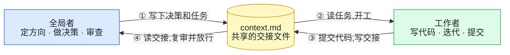

<p align="center"></p>

# Dual-Model Workflow

一套轻量协议:让两个 AI 编码模型分别担任**全局者**和**工作者**,通过几个纯 Markdown 文件协作。解决单个模型上下文耗尽和角色混乱的问题。

**[English](README.md) · 中文**

> 运行在 [Claude Code](https://claude.com/claude-code) 命令行之上,需先自行安装,本仓库不负责安装。Claude 账号**不是必须的**:两个角色都可以接任意 Anthropic 兼容的模型端点,见[前置条件](#前置条件)。

**目录:** [问题](#问题) · [两个角色](#两个角色) · [一轮是怎么跑的](#一轮是怎么跑的) · [文件](#文件) · [前置条件](#前置条件) · [快速开始](#quick-start) · [切换角色](#切换角色) · [高级主题](#高级主题) · [许可证](#许可证)

---

## 问题

用单个 AI 模型做长时间开发,有两个常见问题:

1. **上下文耗尽** —— 对话越长,模型越会丢失早期上下文,反复犯同样的错,或者做着做着把方向带偏。
2. **角色混乱** —— 你想让它做架构决策,它去改代码细节;你想让它执行,它却反复问你方向。

这套工作流的思路是:**把两个模型的角色分开**,用几个纯文本文件管理协作状态,让每个模型只做自己擅长的事。

## 两个角色

- **全局者(`cc`,任意模型,如 Claude)** —— 负责方向、决策、审查。不读大量文件,不做迭代修改,只在关键节点介入:项目启动定架构,工作者遇到分歧给决策,阶段完成做 review。
- **工作者(`cc-alt`,任意模型,如 DeepSeek)** —— 负责执行、迭代、细节实现。读文件、查资料、写代码、改 bug,是实际干活的角色。

两个角色跑在不同的终端 session 里,`cc` 启动全局者,`cc-alt` 启动工作者。(`cc` 和 `cc-alt` 是本仓库 helper 文件定义的 shell 函数,见快速开始,不是 Claude Code 自带的命令。)

## 一轮是怎么跑的



两个会话之间的消息只负责叫醒对方;所有决策都写进 `context.md`,所以任何一方新开会话,只读文件就能接上。更详细的图——谁读写哪些文件、全局者每轮检查什么、一次交接的完整顺序——见 [`docs/diagrams.md`](docs/diagrams.md)(英文版见 [`docs/diagrams.en.md`](docs/diagrams.en.md))。图中蓝 = 全局者,绿 = 工作者,黄 = 文件,灰 = 脚本与检查,紫 = 第三者审查。

## 文件

每个项目里有哪些文件、各自做什么、谁读谁写,以 [`templates/WORKFLOW.md`](templates/WORKFLOW.md) 的「文件分工」表为准。这里有意不写数量 —— 抄过来的数字会和模板走散。最常碰的几个:

- **`WORKFLOW.md`** —— 游戏规则:两个角色各自的职责、触发切换的条件、`context.md` 的写入格式。每次 session 启动两个模型都先读它,确保行为一致。
- **`CLAUDE.md`** —— 项目级启动指令:每次 session 必须 (1) 读 `WORKFLOW.md`,(2) 读 `context.md`(先看顶部当前状态,再看最新历史),(3) 复述「我是[角色],当前任务是:[摘要]」再开始。
- **`context.md`** —— 整个工作流的核心。顶部 `## 当前状态`(全局者每轮覆盖,放最新任务清单;工作者只往其中 backlog、未验证的前提 末尾追加,不覆盖)+ 仅追加的历史记录(每次写入留一条带时间戳的记录)。

它们存在于每个使用该工作流的项目里。另有两份可选文档放在仓库层面,不属于每个项目都有的那一组:[`CROSS-MACHINE.md`](CROSS-MACHINE.md)(全局者与工作者、或两个全局者分处不同机器时)和 [`channel-starter/`](channel-starter/)(没有共同仓库的项目之间用的专用信件信道仓库)。

### `context.md` 长什么样

下面是一个虚构项目的节选:先是全局者写的「当前状态」,再是工作者完成后写的交接块。

```markdown
## 当前状态
**阶段:** Phase 1 / API 骨架
**当前任务:** 实现 POST /todos
**任务清单(给工作者):**
- [ ] 任务 1:建表与迁移(完成标准:`pytest tests/test_db.py` rc=0,可重跑)
- [ ] 任务 2:POST /todos 返回 201(完成标准:`pytest tests/test_todos.py` rc=0,可重跑)
**未验证的前提:**
- [ ] SQLite 够用 —— 依据 spec 里的并发量估计,本侧未复核;核实方式:100 并发写入
**backlog(未决项):** 无

## [2026-01-15 10:20] 工作者 — 完成 POST /todos
**完成情况:** 提交:`a1b2c3d`;任务 1、2 完成
**闸门结果:**
- 单元测试(可重跑):`pytest tests/test_todos.py` —— rc=0;本轮 通过;上一轮 首次
**关键决策点:**
- 架构/接口变动:新增 POST /todos(201 + JSON)
- 安全相关:无
- 偏离原计划:无
- 未解决的疑虑:无
```


## 前置条件

- **已安装 Claude Code** —— `claude --version` 能打印版本号。本仓库不负责安装它。
- **每个角色一个模型。** Claude 账号不是必须的:两个角色都可以接任意 Anthropic 兼容的端点。快速开始里的工作者示例用 DeepSeek,需要 `DEEPSEEK_API_KEY`。
- **bash 和 git**(Linux / macOS),或 **PowerShell 加 Git for Windows**(Windows)。

完整细节——版本、哪些是核心哪些是可选、怎样把全局者接到非 Claude 端点——见[高级主题](#高级主题)里的「前置条件详解」。

<a id="quick-start"></a>

## 快速开始 —— Linux / macOS(bash)

```bash
# 0. 前置条件(见上文)——这里打印「not found」就先停下
command -v git >/dev/null || echo "git not found"
command -v claude >/dev/null && claude --version || echo "claude not found —— 先安装 Claude Code(见前置条件)"

# 1. 克隆
git clone https://github.com/Haven16262/dual-model-workflow.git
cd dual-model-workflow

# 2. 把模板放到默认位置
mkdir -p ~/.dual-model/templates
cp -r templates/. ~/.dual-model/templates/
#   (尾部的 . 同时拷贝 .claude/ 等隐藏目录)
#   (或:export DUAL_MODEL_TEMPLATES=/绝对路径/dual-model-workflow/templates)

# 2b. 安装脚本:安全预检(全局者每次审查前运行)和工作模式规则(cc / cc-alt 读取)是核心;
#     ctx-*.py(context.md 长度与悬空指针检查)和 sessions-md.py(会话注册表)也由全局者每轮 / 每次交接运行;
#     k10-*.py 是可选的第三者审查钩子与值班,拷贝进去无副作用
mkdir -p ~/.claude/scripts
cp scripts/security-scan.sh scripts/dual-model-mode.sh scripts/k10-*.py scripts/ctx-*.py scripts/sessions-md.py ~/.claude/scripts/

# 3. 在 shell 配置里导出你的 DeepSeek key(绝不要提交进仓库)
echo 'export DEEPSEEK_API_KEY="sk-your-deepseek-key"' >> ~/.bashrc

# 4. 引入 helper
echo 'source '"$PWD"'/linux/dual-model.sh' >> ~/.bashrc
source ~/.bashrc

# 5. 在任意项目目录初始化工作流
cd /你的/项目
cc-init        # 复制 WORKFLOW.md + CLAUDE.md + context.md + .claude/{commands,agents,settings.json} + .workflow/

# 6. (可选,仅比赛模式的项目)排上 K9 值班 —— 见 WORKFLOW.md「K10 第三者」
#    */30 * * * * flock -n /tmp/k10-<项目>.lock ~/.claude/scripts/k10-watch.py /项目/路径 >> /日志/路径 2>&1
```

> **命名提醒:** `cc` 会在交互 shell 里覆盖系统 C 编译器(`/usr/bin/cc`)。如果你做 C 开发,改掉 `linux/dual-model.sh` 里的函数名(如 `dm`、`dm-ds`、`dm-init`)。

<details>
<summary><b>快速开始 —— Windows(PowerShell)</b></summary>

```powershell
# 0. 前置条件(见上文)
if (-not (Get-Command git -ErrorAction SilentlyContinue)) { Write-Host "git not found" }
if (Get-Command claude -ErrorAction SilentlyContinue) { claude --version } else { Write-Host "claude not found - 先安装 Claude Code(见前置条件)" }

# 1. 克隆
git clone https://github.com/Haven16262/dual-model-workflow.git
cd dual-model-workflow

# 2. 把模板放到默认位置
New-Item -ItemType Directory -Force "$env:USERPROFILE\.dual-model\templates" | Out-Null
Copy-Item -Recurse -Force templates\* "$env:USERPROFILE\.dual-model\templates\"
Copy-Item -Recurse -Force templates\.claude "$env:USERPROFILE\.dual-model\templates\"
Copy-Item -Recurse -Force templates\.workflow "$env:USERPROFILE\.dual-model\templates\"
#   (通配符不带隐藏目录,.claude/ 和 .workflow/ 要单独复制)
#   (或:$env:DUAL_MODEL_TEMPLATES = "C:\绝对路径\dual-model-workflow\templates")

# 2b. 安装安全预检脚本(在 Git Bash 下运行,Git Bash 随 Git for Windows 提供,Claude Code 并不自带)
New-Item -ItemType Directory -Force "$env:USERPROFILE\.claude\scripts" | Out-Null
Copy-Item scripts\security-scan.sh "$env:USERPROFILE\.claude\scripts\"
#     K10 钩子(可选,Python):钩子命令依次试 python3、python,只用真能跑起来的那个(Git Bash 里的 python3
#     可能是商店占位符);脚本强制 UTF-8 输入输出。2026-09-29 MSI 已测到字节层,CC 里端到端待测。
#     值班 k10-watch.py 依赖 cron + flock,Windows 上没有配。
Copy-Item scripts\k10-*.py "$env:USERPROFILE\.claude\scripts\"
Copy-Item scripts\ctx-*.py "$env:USERPROFILE\.claude\scripts\"
Copy-Item scripts\sessions-md.py "$env:USERPROFILE\.claude\scripts\"

# 3. 准备模型切换用的 settings(key 绝不要提交进仓库)
#    ~\.claude\settings.deepseek.json  — DeepSeek 端点 env + API key(工作者)
#    (全局者直接用你正常的 ~\.claude\settings.json,不用另外准备)

# 4. 在 PowerShell profile 里 dot-source helper
Add-Content $PROFILE ". `"$PWD\windows\dual-model.ps1`""
. $PROFILE

# 5. 在任意项目目录初始化工作流
cd C:\你的\项目
cc-init        # 复制 WORKFLOW.md + CLAUDE.md + context.md + .claude/{commands,agents,settings.json} + .workflow/
```

然后开两个终端:`cc` 跑全局者,`cc-alt` 跑工作者。各自会把角色静默注入系统提示(通过 `--append-system-prompt`,不作为聊天消息发送——第一条消息仍留给你说别的)并读 `WORKFLOW.md` / `context.md` 恢复状态。

选完角色后,脚本还会问一句**本轮话题**(可选,回车跳过)。它和机器标识、项目目录、角色一起构成会话名(通过 `--name`),格式四段:

```
<机器标识>-<项目目录名>-<角色>-<本轮话题>     # 例:vps-bili-overseer-登录态重构
<机器标识>-<项目目录名>-<角色>-<MMDD-HHMM>   # 回车跳过话题时的兜底,例:vps-bili-worker-0820-1145
```

四段各有各的用处,少一段都会出问题:

- **机器标识**——取自 `~/.claude/machine-tag`。**不是**给 AI 分辨机器用的(跨机器时对方显示的是自带主机名的 Remote Control 名字),是给**人**用的:同一个 git 仓库在两台机器上目录名相同,不加前缀的话 claude.ai 和手机的会话列表里会出现两条逐字相同的条目。该文件不存在时不加这一段。
- **项目目录名**——并行开两个项目时,固定叫 `worker` 会让交接消息投递到**另一个项目**的工作者那里,比没有自动化更糟。
- **角色**——同一项目里区分两个终端,交接消息靠它定向。
- **话题**——同一项目每次启动都重名的话,`/resume` 列表里会堆出一排一模一样的条目,你分不出哪个是哪次。`--name` 还会**覆盖** Claude Code 本来会自动生成的摘要标题,所以固定名字不只是没帮上忙,是把原本有用的标题换成了无用的。

代价是发送方不再能凭 cwd 算出对方的完整名字(话题是对方自己填的),发消息前要跑一次 `ListAgents` 按前缀找——见下一节。

</details>

## 切换角色

工作者完成一个阶段或遇到无法决策的问题,写入 `context.md` 后说「已写入 context.md,请切换到全局者」。你去全局者终端输入:

> 「工作者修改了内容,查看 context 文件」

全局者读取后给决策,写入 `context.md`,再说「决策已写入,可切换回工作者继续」。你去工作者终端输入:

> 「全局者修改了内容,查看 context 文件」

这两句话是切换信号,模型收到后会主动读 `context.md`,不需要你重新解释背景。

**Slash 命令简化:** 两句切换话语都有等价的 slash 命令(定义在 `templates/.claude/commands/`):

- 全局者终端:`/as-overseer` ≡ 「工作者修改了内容,查看 context 文件」(意:我现在接手全局者角色)
- 工作者终端:`/as-worker` ≡ 「全局者修改了内容,查看 context 文件」(意:我现在接手工作者角色)

(`as-` 而不是 `from-` 有两个理由:语义上"我现在是什么角色"比"来自谁"更直觉;键盘上 a/s 相邻,比 `from-` 起手 f→r 跨距小,输入更顺。)

语义相同,少打字。手打话语仍然有效。

## 触发切换的条件(工作者 → 全局者)

完整清单以 [`templates/WORKFLOW.md`](templates/WORKFLOW.md) 的「切换触发条件」为准,这里不抄 —— 抄过一次就走散了(本 README 曾只列 4 条,模板早已不止)。大意:架构分歧、安全或性能相关的设计决策、完成一个完整模块、反复尝试仍失败,以及 spec 模糊矛盾或前提被证伪(这两类立刻切回,不先尝试)。

「反复尝试仍失败」那条很重要 —— 与其让工作者反复试错消耗 token,不如切到全局者换个思路。

## 审查机制 —— 以及为什么

早期版本有个藏得很深的问题:**全局者名义上要「阶段性审查工作者输出」,但实际上它根本没在审查。**

问题出在写入格式。工作者完成后只写「完成情况」和「任务进度」—— 全是结果(做完了什么),没有决策(怎么做的、动了什么)。全局者拿着结果摘要,无从判断方向有没有偏、有没有踩安全坑,审查只能停在「看起来做完了」的表面。

修法不是让全局者去读全部代码(那违背它「不读大量文件」的原则),而是让工作者在交付时主动暴露关键决策。工作者写入格式现在带四项强制清单:

```
**关键决策点:**(每项必须显式回答,无则写「无」,不留空)
- 架构/接口变动:...
- 安全相关:是否涉及 认证/密钥/用户输入/SQL/文件路径/外部请求
- 偏离原计划:...
- 未解决的疑虑:继续推进但没把握的点
```

这里有意把**事实上报**和**风险判断**分开:工作者只需如实回答「改没改接口」「碰没碰这些安全敏感面」—— 即使不懂风险也答得出;风险判断交给全局者。其中「未解决的疑虑」是单条价值最高的一项,专门抓那种**工作者没卡住、所以从不触发切换、但其实心里没底**的盲区 —— 这种情况以前完全漏在网外。

配套给全局者加一条硬规则:**只要安全项非空,就必须 invoke `critic` 子代理**(定义在 [`templates/.claude/agents/critic.md`](templates/.claude/agents/critic.md),用 Haiku 跑)去读相关文件并返回结构化审查报告,不能只看摘要。这把"必须读代码"规则操作化了 —— 全局者自己仍不读大量文件,由 critic 子代理代读并出报告,全局者凭报告判断。

但这仍留了一个缺口:逃生口的开关挂在工作者自报上,而模型会反射性填「无」(见下面的告诫)。对策是加一层不依赖自报的客观触发器:全局者每次审查前先跑 [`scripts/security-scan.sh`](scripts/security-scan.sh) —— 纯本地 `grep` 扫 diff 新增行(零 token、不调模型),命中认证/密钥、SQL、命令执行、路径穿越、外部请求等安全敏感关键词就报警。**脚本命中或安全项非空,二者任一,都强制走 `critic` 子代理审查。**命中不等于真有问题,只是把审查从"可选"升级为"必须",脚本给的是触发信号,不是结论。

## 这个补丁不会自动生效(诚实的告诫)

得诚实说一点:整套机制押在工作者**自报诚实**上,而工作者是更小/更便宜的模型。模型有个倾向 —— 为尽快收尾把四项反射性全填「无」,尤其「未解决的疑虑」(承认不确定恰恰是模型最不愿做的)。一旦它在安全项该填却填了「无」,前面那个「安全项非空→必读代码」的逃生口就被空填绕过,整套机制空转。

所以对策不在再改格式,而在全局者的行为:**与某个工作者模型协作的早期,即使它安全项写「无」,也要拿实际 diff 抽查一两次**,先摸清这个工作者到底是诚实自报还是反射填「无」,据此校准对清单的信任度,而不是默认全信。机制设计能做的到此为止,剩下的得靠实跑校准。

## context.md 写入格式

权威的可复制格式(全局者写入、工作者写入、工作者→全局者交接)见 [`templates/WORKFLOW.md`](templates/WORKFLOW.md)。格式统一后,任何一方开启新 session 都能通过历史记录还原完整决策链,不会出现「不知道上次为什么这么做」。

## 高级主题

点开对应条目阅读。第一次跑起来不需要其中任何一项。

<details>
<summary><b>前置条件详解</b></summary>

本仓库是一组模板和 shell helper,**建立在** [Claude Code](https://claude.com/claude-code) 命令行工具之上。Claude Code 只是两个角色共同的运行环境,角色背后用什么模型由你决定。本仓库不负责安装它,也不替代它。开始快速开始之前:

1. **已安装 Claude Code。** 按官方说明安装:<https://claude.com/claude-code>。自检:`claude --version` 能打印版本号。如果找不到 `claude`,`cc` 和 `cc-alt` 会报 `command not found`——而这是**最后**才失败的一步:source helper 和运行 `cc-init` 在没装 Claude Code 时都能成功,前面没有任何提示。
2. **每个角色一个模型,以及登录它的方式。** Claude 账号不是必须的。每个角色本质上就是一个指向某个模型端点的 `claude` 进程:
   - `cc`(全局者)用你默认的 `claude` 配置指向的模型——Claude 登录,或 `ANTHROPIC_*` 环境变量 / `settings.json`,见下面「使用 Claude 以外的模型」。
   - `cc-alt`(工作者)自带一个示例:DeepSeek 的 Anthropic 兼容端点,所以快速开始需要 `DEEPSEEK_API_KEY`。换别的端点就改 `cc-alt` 里的环境变量。
   - 两个角色都可以是非 Claude 模型。2026-10-15 核对过(Claude Code 2.1.300,Linux):在一个全新的 home 目录里、完全没有 Claude 登录,只设 `ANTHROPIC_BASE_URL`、`ANTHROPIC_AUTH_TOKEN` 和模型变量指向 DeepSeek 的 Anthropic 兼容端点,`claude -p` 正常返回,也没有生成凭据文件。**没有核对**:交互式的首次启动界面(print 模式会跳过它),以及其它端点。注意 Claude Code 自己的安装文档写的是需要 Claude 或 Console 账号、或受支持的云 provider——第三方 Anthropic 兼容端点现在能用,但不在文档承诺的范围内,将来可能变。
3. **Shell 与工具。** Linux / macOS:bash 和 git。Windows:PowerShell 加 Git for Windows——Git Bash 随它提供,安全预检脚本需要 bash。(Claude Code 本身不依赖 Git for Windows:没装时它退回用 PowerShell 执行命令。)Python 3 只有下面的可选部分才需要。
4. **Claude Code 版本。** 在 Claude Code 2.1.x 上开发和测试(最近一次核对:Linux 上 2.1.300)。只有跨会话通知有核实过的版本下限(见「让会话自己通知对方」);其余没有核实过下限,行为不对时先升级 Claude Code。

**核心与可选。** 快速开始装的是核心:模板、helper(`cc` / `cc-alt` / `cc-init`)和安全预检。下面这些是可选项,第一次跑可以全部跳过:

- **工作者权限守卫**(需要 Python 3)——见「工作者权限守卫」。
- **K10 第三者审查**(`k10-*.py`,Linux 快速开始第 6 步)——给比赛模式项目用的独立审查会话。值班脚本依赖 cron + flock,Windows 上没有配。
- **跨会话通知**——同机器上任意模型都能用;跨机器需要两端都有 Claude 账号(详见下文和 [`CROSS-MACHINE.md`](CROSS-MACHINE.md))。

### 使用 Claude 以外的模型

在运行 `cc` 之前给全局者设好端点(或把同样的键放进 `cc` 读取的 `settings.json` 的 `env` 里):

```bash
export ANTHROPIC_BASE_URL="https://<你的端点>/anthropic"
export ANTHROPIC_AUTH_TOKEN="<你的 token>"     # 绝不能为空、绝不能不设——见下面的警告
export ANTHROPIC_MODEL="<你的模型名>"
# critic 子代理要的是 `haiku`,比赛模式要的是 `opus`。接非 Claude 端点时这些别名必须解析到你的端点真正提供的模型——
# `cc-alt` 对每一档都做了这件事,你也该做(比赛模式另外认 DUAL_MODEL_MODEL):
export ANTHROPIC_DEFAULT_OPUS_MODEL="<你的模型名>"
export ANTHROPIC_DEFAULT_SONNET_MODEL="<你的模型名>"
export ANTHROPIC_DEFAULT_HAIKU_MODEL="<你的模型名>"
```

> **警告——`ANTHROPIC_BASE_URL` 指向非 Anthropic 主机时,token 绝不能留空或不设。** 2026-09-15 在 Claude Code 2.1.272 上实测:自定义 base URL 且没有 token 时,Claude Code 不报错,而是回落到本机的 Claude 登录,把该账号的 OAuth token 发给了这个自定义端点。`ANTHROPIC_AUTH_TOKEN=$VAR` 而 `$VAR` 为空走的是同一条路径;PowerShell 里给 `$env:X` 赋空串(等于删变量)也一样。`cc-alt` 会检查密钥非空并中止;你自己写的任何启动器都必须做同样的检查。机器上没有 Claude 登录就没有东西可泄露,但检查仍然建议保留。

会话之间的消息不取决于背后的模型:同机器上的 `SendMessage` 在两个都跑第三方端点的会话之间可用(作者的 VPS 上用 DeepSeek 会话实测过),Claude Code 官方文档(2026-09-18 核对)也把同机消息列为在所有 provider 上可用(≥ 2.1.248)。用 `/list-agents` 确认你的会话里有这个功能。设置 `CLAUDE_CODE_DISABLE_NONESSENTIAL_TRAFFIC`、`DISABLE_TELEMETRY`、`DO_NOT_TRACK`、`DISABLE_GROWTHBOOK` 中任意一个,会让这个功能静默关闭(来自作者笔记,以 `/list-agents` 为准)。**跨机器**则不同:那条路需要两端都有 Claude 账号——见让会话自己通知对方和 [`CROSS-MACHINE.md`](CROSS-MACHINE.md)。

</details>

<details>
<summary><b>让会话自己通知对方</b></summary>

上面那两步「你走到另一个终端敲字」可以省掉。Claude Code 支持跨会话消息(`SendMessage` + `ListAgents`),两个终端同时开着时,写完 `context.md` 的一方直接通知对方,对方按 `/as-worker` / `/as-overseer` 的完整流程接手。

版本门槛分两档:**macOS / Linux / WSL 2 需 ≥ 2.1.224,原生 Windows 需 ≥ 2.1.234**。用 `/list-agents`(别名 `/peers`)自查:命令本身不认识就是没有这个功能。

会话名的前三段(机器标识 + 项目目录 + 角色)发送方算得出,最后一段话题算不出。所以发消息前**跑一次 `ListAgents`**,找名字以 `vps-bili-worker-` 开头的那一行,按行里印的完整名字发送;**恰好一条**才发,零条或多条一律回退人工。这一次查询是流程的一部分,不是故障排查。

名字唯一时直接按名字投递,不再需要先带 `[ref]` 确认(2.1.232 起)。你自己也可以在 prompt 里打 `@` 加名字前几个字母,从候选里挑一个会话点名——省掉让模型先查一遍。

一条铁律:**消息只负责叫醒和指路,决策内容一律仍然写 `context.md`。**

> 这条不是洁癖。本工作流的核心承诺是「任何一方新开 session 都能只靠文件还原完整决策链」;消息是易失的,不进文件就等于没发生过。一旦决策开始走消息,承诺立刻作废,而且失效得悄无声息——当下能跑,回头追溯时才发现断链。

发送失败(对方没开终端、名字对不上、版本或平台不支持)时,**回退到人工中转,不重试**。所以这是可选加速,不是新的必经路径:自动通道断了,工作流退化成原来的样子,照常运转。

**可选:让平台替你盯着。** 全局者交出任务时可以带上 `notify_when_idle`(≥ 2.1.236,仅同机器),请平台在工作者下次空闲时回一条通知。好处是不依赖工作者记得发消息;代价是它只说「空闲了」,不说「交接好了」——收到后仍要读 `context.md` 确认有没有新交接块。

**平台状态:** 跨会话消息最初只有 macOS 和 Linux,Windows 从 2.1.234 起补齐,现在三端都可用。`windows/dual-model.ps1` 已跟进会话命名,本节对 Windows 同样生效。模板不为平台分叉,两端行为一致——只有非 ASCII 目录名的哈希兜底实现不同(Linux 用 `cksum`,PowerShell 没有,改用 SHA256 前 8 位十六进制),两边都只保证「同路径永远同结果」,不保证跨平台算出同一个值。

同机器上两个终端直接走本地 socket(Windows 上是命名管道),不经过 Anthropic 服务器;**跨机器**(比如 VPS 和本地电脑)才需要两端都登录 Claude 账号并连上 Remote Control,消息经 Anthropic 服务器中转。没有 Claude 账号这条路就走不通——交接里「共享仓库」那一半照旧,只是那条一句话的指针消息要靠别的渠道送(聊天、邮件、webhook、别的开源消息工具,或自己搭的东西),见 [`CROSS-MACHINE.md`](CROSS-MACHINE.md)。另外 WSL 2 里的会话和同一台电脑上的原生 Windows 会话**互相看不见**——注册在不同的 home 目录,socket 类型也不同。

跨机器该怎么组织工作流——用共享 git 仓库当交接介质、寻址方式的差异、Linux ↔ Windows 的换行符/路径/时区坑——单独写在 [`CROSS-MACHINE.md`](CROSS-MACHINE.md)。同机使用不需要读。

> **测试时的坑:** 从一个 Claude Code 会话里 spawn 出来的终端会继承 `CLAUDE_CODE_CHILD_SESSION` 环境变量,那个会话**不会注册进 peer 列表**,`ListAgents` 里根本看不见(终端里会提示 `Transcript saving is off — inherited CLAUDE_CODE_CHILD_SESSION marker`)。真人在干净终端里敲 `cc` 不会遇到,但脚本化验证这套机制时会栽进去,而且现象和"名字对不上"一模一样。

**别指望它做无人值守自动循环。** 发给「已跳过权限确认」会话的跨会话消息会被扣住等人工批准(平台设计如此)。这套机制省的是打字和上下文切换,不省盯着——这跟本工作流「人是检查点」的前提是一致的。

</details>

<details>
<summary><b>工作者权限守卫</b></summary>

> **默认不装,完全可选。** 本仓库不会自动安装守卫,也不自带任何权限规则(`allow` / `ask` / `deny`)——下文提到的 `ask` 规则来自作者个人的 `settings.json`,不在仓库里。不装守卫的话,工作者按你已有的权限配置运行,没有任何东西拦它执行 `git push`:「工作者不推送」这条规则此时只是 `WORKFLOW.md` 里的文字。不想要守卫?跳过本节,并删除 `scripts/worker_guard.py`、`scripts/cc_allow_once.py`、`scripts/worker_guard_test.sh` 和 `skills/allow-once/`。想要?照下面的安装步骤做就行。`WORKFLOW.md` 模板里有一节「命令被守卫拦下时」是以装了守卫为前提写的——不装守卫就忽略或删掉它。

工作者会话**连不上 Remote Control**：`cc-alt` 把 `ANTHROPIC_BASE_URL` 指向本地网关，而 Claude Code 在这个变量指向 `api.anthropic.com` 以外的主机时一律拒绝 Remote Control。同时权限弹窗**永不超时**。两条叠起来：你不在工位时工作者撞上弹窗，不是"等一会儿"，是无限期挂死。(Remote Control 本身需要 Claude 账号;没有账号时任何会话都用不了它,弹窗没人答照样挂死。)

守卫是个 `PreToolUse` 钩子，在弹窗打开**之前**把这些命令拒掉——「跳过去做别的」这个选项只有这样才存在。

| 类别 | 命令 | 行为 |
|---|---|---|
| 硬拒 | `git push` | 没有放行通道。工作者提交、记录状态、交接给全局者，由全局者复审后自行发布 |
| 拒 + 窗口 | `ssh`、`chmod` | 自动入队。你敲 `/allow-once` 开 10 分钟窗口，工作者重试，正常弹窗照常出现 |

拦截集合刻意与**参考配置**的 `settings.json` 里那三条 `ask` 规则对齐（`chmod` / `ssh` / `git push`）——在那台机器上它们是工作者唯一会撞上的弹窗来源。**你的机器可能一条 `ask` 规则都没有**，那时这些命令在非 auto 模式下走默认弹窗流程照样会弹，而守卫就成了工作者与「没人能答的对话框」之间唯一的东西。别默认两边的清单对得上，先查自己的规则。

两条值得写明的性质：

* **开窗不等于授权。** 它只让弹窗能弹出来，权限仍然来自你在弹窗上点的那一下。
* **模型不能给自己开窗。** `allow-once` skill 设了 `disable-model-invocation: true`，其 `!` 行在展开阶段执行、早于模型看到任何内容——开窗在结构上就是人的动作。

安装（两端通用，脚本是 Python 不是 shell）：

```bash
cp scripts/worker_guard.py scripts/cc_allow_once.py ~/.claude/scripts/
mkdir -p ~/.claude/skills/allow-once && cp skills/allow-once/SKILL.md ~/.claude/skills/allow-once/
echo vps > ~/.claude/machine-tag        # 或 msi / n1 …… 每台机器一个短标识
```

然后把钩子加进**只有工作者加载**的那个设置文件（`~/.claude/settings.deepseek.json`），**绝不要加进 `settings.json`**——全局者必须保留它的正常弹窗，因为(有 Claude 账号时)它才是能经 Remote Control 推到你手机的那个会话：

```json
{ "matcher": "Bash",
  "hooks": [{ "type": "command",
              "command": "python3 -S \"$HOME/.claude/scripts/worker_guard.py\"",
              "timeout": 10 }] }
```

Windows 上钩子命令和 `SKILL.md` 里都要**写解释器的完整路径**，例如 `E:/Anaconda/python.exe`。不要因为 `python3` 能解析就认为它可用：默认 Windows 装机环境里 `python3` 是微软商店的占位符，**在 PATH 上但不是解释器**，退出码 9009 并提示 *"Python was not found"*。钩子指向它就会失败，而失败的钩子是**失败放行**的钩子。裸 `python` 在 Git Bash 里可能好用，从钩子里却未必——钩子执行时的 PATH 不是 Bash 那份。

`SKILL.md` 里解释器出现**两次**——`allowed-tools` 里一次，`!` 行里一次——两处必须**逐字一致**。Claude Code 会拿注入的命令去比对规则，比对结果不是 `allow` 就**中止整个调用**：改了一处漏了另一处，不是让 skill 变差，是让它彻底失效。

**编码同样是个坑。** 这两个脚本在代码里把 `sys.stdout` 定死成 UTF-8，而不是靠钩子命令写 `-X utf8`：Claude Code 按 UTF-8 解析钩子 stdout，而 Python 默认走 locale 编码（简中 Windows 是 cp936）。一旦错开，JSON 解析失败、`permissionDecision` 丢失、命令照常执行。**失败放行的守卫比没有守卫更危险**——它让人以为 `git push` 被挡住了，其实没有。测试套件里有专门一条查这个，别跳过。

**Linux 用户注意确认 `cc-alt` 真的传了这个文件。** Linux 侧端点走环境变量，`settings.deepseek.json` 是可选的、很容易漏——而钩子写在一个没人加载的文件里是**静默失效**，不会报错。`linux/dual-model.sh` 里的 helper 在文件存在时会传；如果你 source 的是这个功能之前的旧副本，重新 source 一次。

装完验证：

```bash
bash scripts/worker_guard_test.sh          # 或: bash scripts/worker_guard_test.sh python
```

22 条分类用例，其中包括催生这个解析器的那几条：`git log --grep push`、以及 heredoc 正文里写着 `git push` 例子的情况，**都不能**被拦——硬拒路径没有逃生舱，误伤会把工作者卡死在一条无害命令上。

</details>

<details>
<summary><b>仓库布局</b></summary>

```
templates/   # markdown 模板 —— 平台无关,两端共用
scripts/     # security-scan.sh —— bash,两端都能跑(Windows 走 Git Bash)
#              worker_guard.py + cc_allow_once.py + worker_guard_test.sh
#              dual-model-mode.sh —— 工作模式规则,启动器调用它
#              ctx-size.py + ctx-pointers.py —— context.md 长度与悬空指针检查,全局者每轮运行
#              sessions-md.py —— 会话注册表,每次交接运行
#              k10-watch.py / k10-stop-gate.py / k10-subagent-report.py —— 可选:第三者审查(K10)
#              tests/ —— bash test_dual_model_mode.sh ; test_k10.sh ; test_security_scan.sh ; test_ctx_pointers.sh ; test_sessions_md.sh(测试套件只支持 Linux,未移植到 Windows)
docs/        # docs/design/ 是设计记录(模板为什么这么写);工作流图在 diagrams.md(中文)/ diagrams.en.md(英文)
skills/      # allow-once —— 装进 ~/.claude/skills/
channel-starter/ # 可选:专用信件信道仓库的起步包(见 CROSS-MACHINE.md)
linux/       # bash helper(cc / cc-alt / cc-init)—— source 进 ~/.bashrc
windows/     # PowerShell helper(同名命令)—— dot-source 进 $PROFILE
```

只有 shell helper 按平台分开,其余(模板、安全扫描、许可证)都放仓库根共享。跨机器同步工作流更新:每台机器 `git pull` 即可,被 source 的 helper 文件原地更新。

两个移植版有一处真实的行为差异:**模型切换**。Linux 版在启动时用命令前缀环境变量注入 DeepSeek 端点;Windows 版用 `claude --settings ~\.claude\settings.deepseek.json` 传入。两种做法都只作用于单个会话,两个终端互不干扰。不要用"覆盖 `~\.claude\settings.json`"的方式切模型——那个文件被所有正在运行的 Claude Code 进程共享,改它会热重载到其它终端里已经在跑的会话上。详见各 helper 文件的头部注释。

</details>

<details>
<summary><b>相关工作</b></summary>

把 AI 编码工作拆给一个强"规划者 / 架构师"模型 + 一个弱 / 更便宜的"执行者"模型,这个模式有大量先例。本仓库只是其中一种特定实现,不是新颖设计。值得知道的 prior art(每一项的现状均于 2026-10-15 对照 GitHub 核对过):

**成熟框架:**
- [aider](https://github.com/Aider-AI/aider) —— `--architect` 模式在单一 CLI 内把规划者模型和编辑者模型配对。是本仓库思路最直接的概念父本。仍在维护(最近提交 2026-05-22),该选项仍在其参数列表里。
- [MetaGPT](https://github.com/FoundationAgents/MetaGPT)(已从 `geekan/MetaGPT` 迁移)、[CrewAI](https://github.com/crewAIInc/crewAI)、[LangGraph](https://github.com/langchain-ai/langgraph) —— 多 agent 框架,角色化编排,规划者 / 执行者是它们支持的经典分工之一。CrewAI 和 LangGraph 开发活跃;MetaGPT 最近一次提交是 2026-01-21。
- [AutoGen](https://github.com/microsoft/autogen) —— 现已进入**维护模式**:不再加新功能,由社区维护。它的 README 把新用户引向继任者 [Microsoft Agent Framework](https://github.com/microsoft/agent-framework)。
- [cline](https://github.com/cline/cline) —— IDE 内嵌的 agent,带 Plan / Act 模式分离;开发活跃,现在也提供 SDK 和 CLI 形态。[Roo Code](https://github.com/RooCodeInc/Roo-Code)(原 `RooVetGit/Roo-Cline`)已被**归档**(只读);最后一个版本是 2026-05-15 的 v3.54.0。

**直接重叠的小仓库**(创建于 2026 年 3 月到 5 月之间,早于本仓库;本仓库创建于 2026-05-19):
- [chewwwwwwwwww/claude-codex-hybrid-kit](https://github.com/chewwwwwwwwww/claude-codex-hybrid-kit) —— Claude Code 和 Codex 通过每个 issue 一个 Markdown 文件(`issue-N.md`)作总线分工,由显式 slash commands 驱动(`/scope → /architect → /build → /review → /verify`):Claude 负责定范围、实现和验证,Codex 负责架构和审查,每一步由人手动触发。用 Codex 而非 DeepSeek,把流程固定成流水线。体量很小(2 star);最近提交 2026-04-27。
- [SelimCakil/claude-deepseek-architect](https://github.com/SelimCakil/claude-deepseek-architect) —— Claude 当架构师,DeepSeek、Kimi、Gemini 当开发者:独立的部分经按供应商划分的启动器配置(各自独立的 Claude Code 配置目录)并行派发,另有一个可选的 MCP 服务器(houtini-lm)做文本交接。派发是自动的,不是人介入切换。README 是土耳其语。最近提交 2026-07-22。
- [evan-e2438927/sdlc-workflow](https://github.com/evan-e2438927/sdlc-workflow) —— 偏重的 SDLC 流水线,以 Claude Code 和 Codex 的 skill 插件形式提供:Claude Code 写,Codex CLI 在形式化门禁处审查,浏览器自动化验证(`proposal → apply → qa → accept → pr`),一条命令(`doit`)可把所有阶段串到提 PR。27 star;最近提交 2026-09-26。

**2026-10-15 在 GitHub 搜索中另外看到的**——只依据各仓库自己的一句话简介判断,没有细看也没有试用:
- [tristanMatthias/bot2bot](https://github.com/tristanMatthias/bot2bot) —— 多个 Claude Code 会话之间的协调,面向"overseer / worker"场景。
- [joancarvajal80/sfcrew](https://github.com/joancarvajal80/sfcrew) —— Claude Code 当架构师,加上无界面的 DeepSeek / GLM / Claude 执行器,通过 `tasks.csv` 协调。
- [aravindhsampath/agentic-template](https://github.com/aravindhsampath/agentic-template) —— 项目模板,带架构师和工程师子代理,以及多模型代码审查(DeepSeek + Kimi)。

**本仓库的差异点(小,但真实):**
- **人介入切换 + 显式触发话语**,而非程序化派发(claude-deepseek-architect 和 sdlc-workflow 的 `doit` 属于后者)。claude-codex-hybrid-kit 同样是人手动触发,所以这一点不是独有的;本仓库的不同在于共享状态是每个项目一份仅追加的 `context.md`,而不是每个 issue 一个文件。代价是慢,好处是透明、零额外依赖——只要有 Claude Code 就能跑。
- **四项「关键决策点」清单**,工作者每次交付强制填,事实上报与风险判断分离。
- **关于清单为何不自动生效的诚实告诫**——工作者模型可能反射性填「无」,全局者需要抽查 diff 校准信任度。我在上面列出的仓库的 README 里没有找到对这条局限的讨论(2026-10-15 核对,仅读了 README)。

如果你想要更自动化 / 更重型的方案,优先选 aider 的 architect 模式或上述仍在积极维护的多 agent 框架。本仓库面向的场景是:你想要双模型分工,但不想引入 Claude Code 之外的任何额外依赖。

</details>

## 许可证

MIT —— 见 [LICENSE](LICENSE)。
