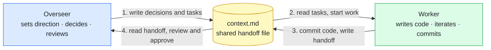
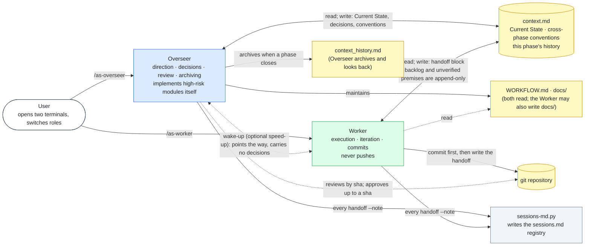
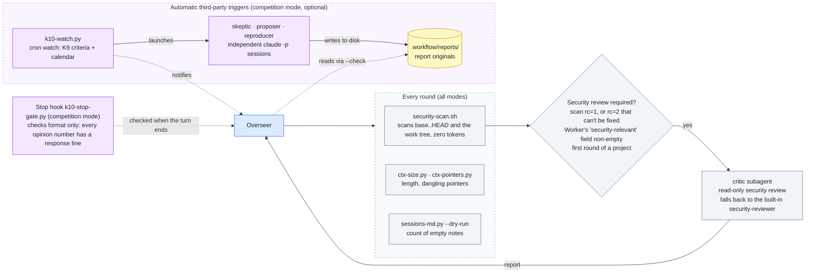
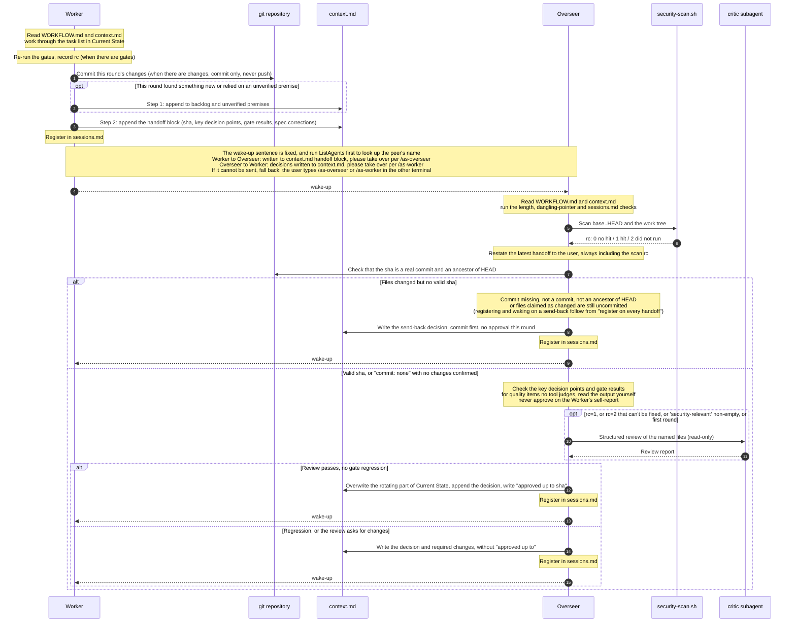

# Workflow diagrams

> 中文版：[diagrams.md](diagrams.md)

> This page holds diagrams only. The rules live in [`templates/WORKFLOW.md`](../templates/WORKFLOW.md); if a diagram disagrees with it, fix the diagram.
> The diagrams deliberately state no file counts and no version numbers — numbers like that drift. For the list of files, see the "file roles" table in WORKFLOW.md.

## Overview: start here

Two models each own one half of the job and hand off through a shared file, not through chat history. The diagrams below expand this: who reads and writes which file, what is checked each round, and the full sequence of one handoff.

- **Why split the roles:** one model working for long enough runs out of context and starts to blur roles. Two models, each doing only what it is good at, avoid that.
- **Why go through a file:** messages between the two sessions only wake the other side up; every decision is written into `context.md`, so a fresh session on either side can pick up from the files alone.

## Diagram 1a: core — two roles, shared files, commits

Solid arrow = write or run; dashed arrow = read or notify; double-headed arrow = read and write.

Colors: blue = Overseer, green = Worker, yellow = files, grey = scripts and checks, purple = third-party reviewers.

### Diagram 1a: what to take away

- **Files are the only carrier of decisions.** Messages between the two sessions only wake the other side up and point the way; every decision is written into `context.md` first, so a fresh session on either side can reconstruct the decision chain from the files alone.
- **The Worker commits but never pushes.** Publishing is decided by the Overseer after review; what gets approved is a real commit, recorded in `context.md` as "approved up to sha".
- **`sessions.md` is not a decision carrier.** It is a session list for humans, written by a script; each role only supplies its own line through `--note`.

## Diagram 1b: the Overseer's checks each round, and third-party reviewers

The upper half is the set of checks present in every mode; the lower half is the automatic trigger machinery for third-party reviewers (competition mode). Outside competition mode, the Overseer can still summon a skeptic by hand for architecture decisions.

### Diagram 1b: what to take away

- **Security review does not rely on self-reporting alone.** A scan hit forces it even when the Worker wrote "none" under security; conversely, a non-empty self-report triggers it too.
- **critic is available in every mode** and is a verifier-type subagent; only the `k10-watch.py` watch and the Stop hook are limited to competition mode.
- **The Stop hook checks format only, and only when the Overseer ends its turn:** with no response, it blocks. A single line "S1 S2 S3 accepted" satisfies it, and it does not guarantee the responses were written with care.

## Diagram 2: sequence of one handoff (the Worker finishes a module)

This is the most common round: the Worker finishes a complete module and hands it to the Overseer, who reviews it, then either approves or sends it back, and gives the next step. Other reasons to switch (a disagreement on direction, a contradictory spec, a broken premise, and so on) follow the same "write the file first, then wake the other side" order; only the handoff block's format and the Overseer's handling differ — see "switch trigger conditions" in WORKFLOW.md.

### Diagram 2: what to take away

- **The order cannot change: commit, then write the file, then wake the other side.** The handoff block records the sha of this round's commit; the wake-up message carries no decisions and only points the way.
- **The scan runs before the sha check, unconditionally, every round.** The send-back branch already has the scan result.
- **Approval is only given after a passing review.** With a gate regression, or when the review asks for changes, the Overseer writes only the decision and the required changes, and does not write "approved up to".
- **What the Overseer approves is a real commit.** "Approved up to sha" goes into `context.md` and becomes the base of the next round's scan, so uncommitted changes in the work tree cannot be approved.
- **Several details are left out of the diagram**; see WORKFLOW.md: checking the five mandatory-escalation categories when architecture or interfaces change, when re-runnable gates are re-run, and how critic gets registered when the session starts outside the project directory.
