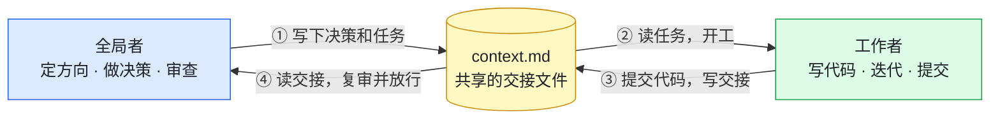
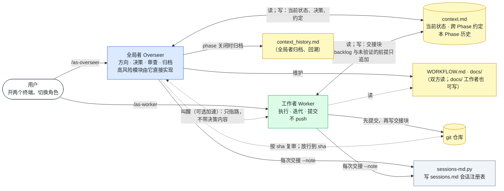
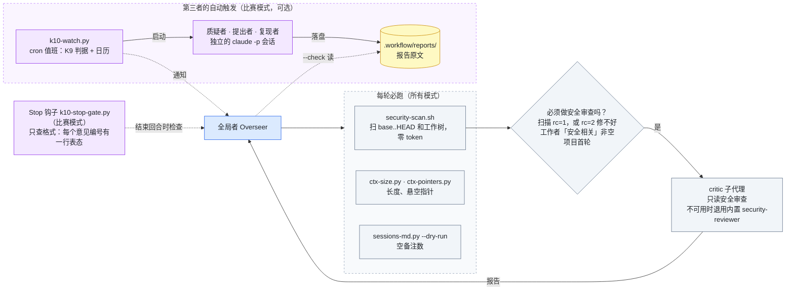
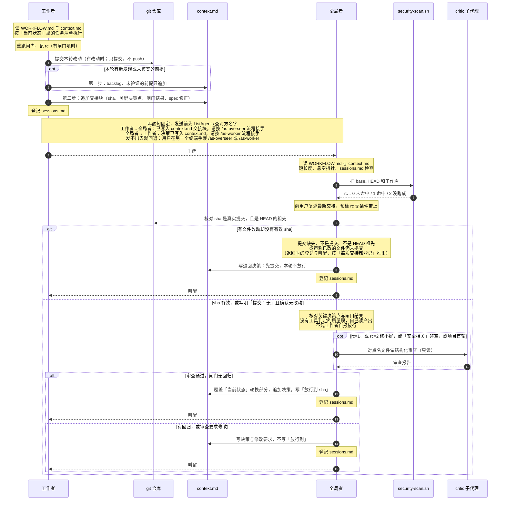

# 工作关系图

> English version: [diagrams.en.md](diagrams.en.md)

> 这页只放图。规则以 [`templates/WORKFLOW.md`](../templates/WORKFLOW.md) 为准，图和它冲突时改图。
> 图里不写文件总数、不写版本号：这类数字会漂，文件清单看 WORKFLOW.md 的「文件分工」表。

## 概览：先看这张

两个模型各管一摊事，靠一份共享文件交接，不靠聊天记录。下面几张图是展开：谁读写哪些文件、每轮检查什么、一次交接的完整顺序。

- **为什么这样分：** 一个模型做到最后，上下文会耗尽、角色会混。拆成两个，各自只做擅长的事。
- **为什么走文件：** 两个会话之间的消息只负责叫醒；决策一律写进 `context.md`，任何一方新开会话，只读文件就能接上。

## 图 1a：核心——两个角色、共享文件、提交

实线 = 写或执行；虚线 = 读或通知；双向箭头 = 又读又写。

颜色：蓝 = 全局者，绿 = 工作者，黄 = 文件，灰 = 脚本与检查，紫 = 第三者。

### 图 1a 读图要点

- **文件是唯一的决策载体。** 两个会话之间的消息只负责叫醒、指路；任何决策都先写进 `context.md`，所以任何一方新开会话，只读文件就能还原决策链。
- **工作者只提交、不 push。** 发布由全局者复审后决定；放行的是一个真实提交，写成「放行到 sha」记进 `context.md`。
- **`sessions.md` 不是决策载体。** 它是给人查的会话清单，由脚本写，角色只通过 `--note` 提供自己那一行。

## 图 1b：全局者每轮的检查，以及第三者

上半是每个模式都有的检查；下半是比赛模式的第三者自动触发机制（非比赛模式下，架构决策时也可以手动召唤质疑者）。

### 图 1b 读图要点

- **安全审查不只靠自报。** 脚本命中也强制触发，即使工作者在「安全相关」写了「无」；反过来，自报非空同样触发。
- **critic 在所有模式下都可用**，是验证者类的子代理；只有 `k10-watch.py` 的值班和 Stop 钩子限于比赛模式。
- **Stop 钩子只管格式，且在全局者结束回合时才检查：** 没有回应就拦下。一行「S1 S2 S3 接受」就能满足它，不保证回应是认真写的。

## 图 2：一轮交接的时序（工作者完成一个模块）

这是最常见的一轮：工作者做完一个完整模块，交给全局者审查，全局者审查后放行或退回，并给出下一步。其他切换原因（方向分歧、spec 矛盾、前提不成立等）走同样的「先写文件、再叫醒」顺序，只是交接块的格式和全局者的处理不同，见 WORKFLOW.md「切换触发条件」。

### 图 2 读图要点

- **顺序不能换：先提交、再写文件、最后叫醒。** 交接块要写本轮提交的 sha；叫醒消息不带决策内容，只指路。
- **扫描在核对 sha 之前就跑，每轮无条件。** 退回分支也已经拿到了扫描结果。
- **放行是审查通过之后才有的。** 闸门有回归、或审查要求修改时，全局者只写决策和修改要求，不写「放行到」。
- **全局者放行的是一个真实提交。** 「放行到 sha」写进 `context.md`，下一轮扫描的 base 就从这里取，所以工作树里未提交的改动不能放行。
- **图里省略了几处细则**，见 WORKFLOW.md：架构或接口变动时核对强制升级的五类、可重跑闸门何时重跑、critic 在项目目录之外启动时的注册问题。
